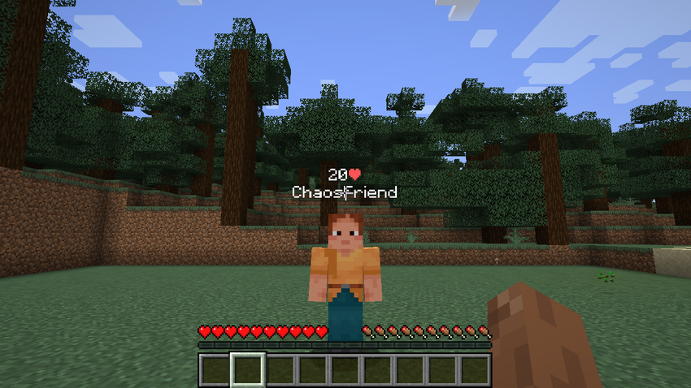
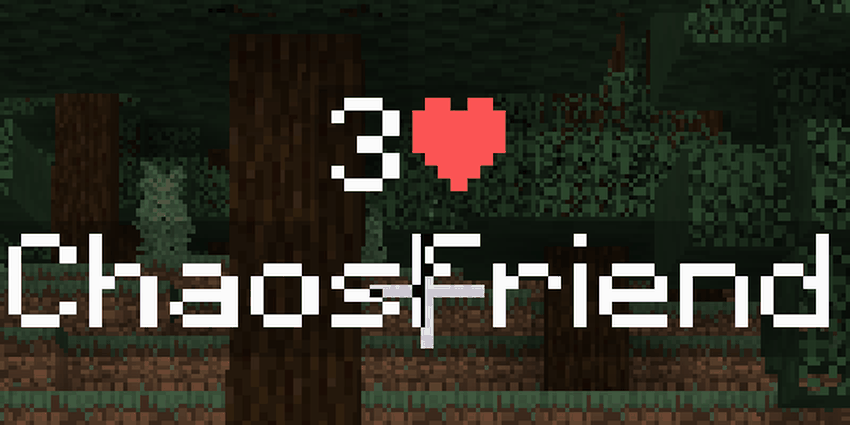
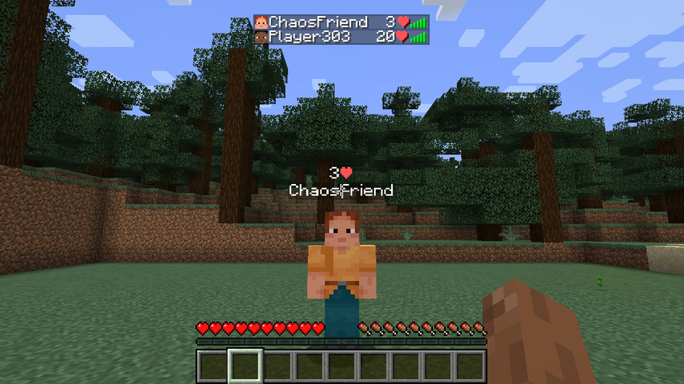

# See everyone's health, live.

**Chaos Heart** shows every player's health in real time **above their nametag** and in the **TAB list** as **20❤**. Built for Fabric 1.21.1.



## ✨ Features

- **Real-time health** above the nametag and in TAB, for every player on the server.
- **Golden heart** above 20: absorption and extra hearts from other mods are included.
- **Beating heart** when a player drops to 2 hearts or less.
- Players without the mod still see it in TAB and below the name.





## ⚙️ Config

`config/chaosheart.json`: `showInTab`, `showAboveName`, `symbol`.

## 📦 Requirements

Minecraft 1.21.1 · Fabric Loader 0.16+ · Fabric API. Install on **server and client** for the full experience.

## 🛠️ Build

```bash
./gradlew build
```

The jar ends up in `build/libs/`. `./gradlew runSelftest` regenerates the screenshots.

## License

MIT
